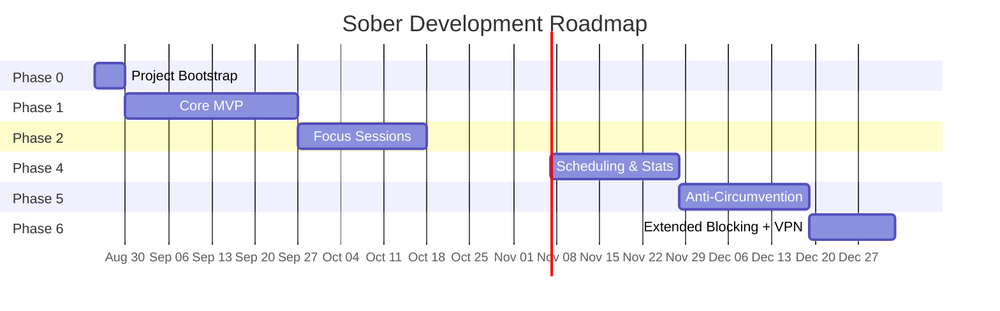
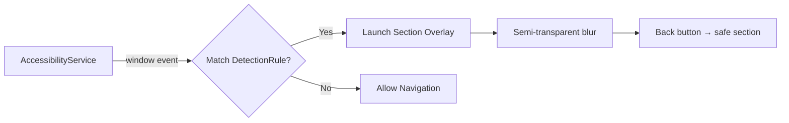

# Sober — Implementation Plan

> **Version**: 1.0  
> **Last Updated**: 2026-08-19  
> **Source**: Sober PRD v1.0 (`Required/Sober_PRD.docx`)  
> **Architecture**: Clean Architecture (Presentation → Domain → Data) + MVVM  
> **Platform**: Android (Kotlin 2.0+, Jetpack Compose, Material 3)

---

## Overview

Sober is split into **6 implementation phases** plus a cross-cutting notifications system. Each phase is self-contained and produces a shippable increment. Phases are sequential — Phase N+1 depends on infrastructure built in Phase N.



---

## Phase 0 — Project Bootstrap & Environment

**Duration**: ~3–5 days  
**Goal**: Working empty shell with all modules, dependencies, and a clean build.

### What Happens

1. **Android Studio setup** — install latest stable + SDK 35, JDK 17+
2. **Create project** — `com.sober.app`, Empty Compose Activity, Kotlin DSL
3. **Module creation** — 12 Gradle modules matching the PRD architecture:

```
:app
├── :core:data       — Room DB, DataStore, Repositories impl
├── :core:domain     — Use cases, Models, Repository interfaces
├── :core:ui         — Design system: Colors, Type, Components
├── :core:common     — Extensions, utils, constants
├── :feature:home    — Dashboard, stats ring
├── :feature:apps    — App list, per-app settings
├── :feature:focus   — Focus session start, history
├── :feature:stats   — Charts, heatmap, achievements
├── :feature:settings— Settings, permissions, onboarding
├── :system:services — ForegroundService, AccessibilityService
├── :system:overlay  — Block overlay Activity + ViewModel
└── :system:receivers— BootReceiver, AlarmReceiver
```

4. **Dependency injection** — Hilt setup with `@HiltAndroidApp`
5. **Version catalog** — `libs.versions.toml` with all dependencies:
   - Room 2.6.x, Hilt 2.50+, Compose Material 3 1.2.x
   - Vico 1.13.x, Coil 2.6.x, Lottie Compose 6.3.x
   - WorkManager 2.9.x, Accompanist 0.33.x, Moshi 1.15.x
   - JetBrains Mono + Inter fonts
6. **Git** — init repo, `.gitignore`, first commit
7. **Verification** — clean build passes on all modules, instrumented test harness works

### Exit Criteria

- `./gradlew assembleDebug` passes with zero errors
- All 12 modules are visible in Project view
- Hilt compiles cleanly
- An empty Compose screen renders on emulator

---

## Phase 1 — Core MVP: Hard App Limits + Basic Overlay

**Duration**: 4 weeks  
**Goal**: Users can set per-app daily limits. When a limit is hit, the app is hard-blocked with a full-screen overlay. Foreground service persists across reboot.

### Sub-Phases

#### 1A — Design System (`core:ui`) — Days 1–3

Build the Manuscript visual identity as reusable Compose primitives.

| Token | Value | Usage |
|-------|-------|-------|
| Background | `#F7F4EF` | Entire screen background |
| Surface | `#FFFFFF` | Cards only |
| Card Border | `#E8E0D5` | 1px border on all cards |
| Primary (Ink Navy) | `#1A1A2E` | CTAs, active nav, headings, button fills |
| Danger (Signal Red) | `#C0392B` | Blocked states only — never decorative |
| Warning (Warm Brown) | `#8B6F47` | 80% warnings, streak-at-risk |
| Text Primary | `#1A1A1A` | Body copy |
| Text Secondary | `#6B6560` | Supporting text, timestamps |
| Text Muted | `#9C9490` | Placeholders, disabled states |

**Typography**: Inter (SemiBold 32/24sp, Medium 20/14/11sp, Regular 16/14sp) + JetBrains Mono Regular 14sp.

**Components**: `SoberCard`, `SoberButton`, `SoberOutlinedButton`, `SoberProgressBar`, `SoberSegmentedControl`, `SoberToggleSwitch`, `SoberSectionLabel`.

#### 1B — Data Layer (`core:data` + `core:domain`) — Days 4–8

| Entity | Key Columns |
|--------|-------------|
| `AppLimit` | packageName, appName, dailyLimitMinutes, isActive, blockedSections (JSON), createdAt |
| `UsageSession` | packageName, date (YYYY-MM-DD), usedMinutes, lastUpdated |
| `FocusSession` | label, durationMinutes, startedAt, endedAt, status (ACTIVE/COMPLETED/CANCELLED), blockedApps (JSON) |
| `ScheduleRule` | ruleName, blockedPackages (JSON), daysOfWeek (JSON), startTime, endTime, isActive |
| `OverrideLog` | packageName, overrideAt, durationGrantedMinutes, sessionId (FK) |

**DataStore keys**: overall_daily_limit, pin_hash, theme, streak_current, streak_longest, streak_last_success, onboarding_complete, feature_flags.

**Repositories**: interface in `:core:domain`, implementation in `:core:data`. All data access goes through use cases.

#### 1C — Onboarding (`feature:settings`) — Days 9–12

6-step flow with progress dots. Steps 2–5 are mandatory (permissions). Plain English copy.

| Step | Permission | Detection |
|------|-----------|-----------|
| 1 — Welcome | None | N/A |
| 2 — Usage Stats | `PACKAGE_USAGE_STATS` | `AppOpsManager.checkOpNoThrow()` |
| 3 — Accessibility | `BIND_ACCESSIBILITY_SERVICE` | Check if service is enabled in `Settings.Secure` |
| 4 — Notifications | `BIND_NOTIFICATION_LISTENER_SERVICE` | `NotificationManagerCompat.getEnabledListenerPackages()` |
| 5 — Overlay | `SYSTEM_ALERT_WINDOW` | `Settings.canDrawOverlays()` |
| 6 — Device Admin | `BIND_DEVICE_ADMIN` | `DevicePolicyManager.isAdminActive()` |

#### 1D — UsageStats Integration (`system:services`) — Days 13–16

- `UsageStatsRepository` wraps `UsageStatsManager.queryUsageStats()`
- Polls every 30 seconds via the Foreground Service
- Syncs to Room `UsageSession` table
- Handles midnight rollover, missing apps, system apps exclusion

#### 1E — Block Overlay (`system:overlay`) — Days 17–20

Full-screen overlay Activity using `SYSTEM_ALERT_WINDOW`:

```
┌─────────────────────────────────┐
│ Sober                    (12sp) │
│                                 │
│         [App Icon 64dp]         │
│          ◯ red 2dp ring         │
│                                 │
│  "You've had enough Instagram   │
│   for today."         (22sp)    │
│                                 │
│  "Daily limit reached." (14sp)  │
│  ─────────────────────────────  │
│        ╭──────────────╮         │
│        │  Back at      │        │
│        │  midnight     │        │
│        │  12:00 AM     │        │
│        ╰──────────────╯         │
│                                 │
│  "Need an override?"    (11sp)  │
└─────────────────────────────────┘
```

No back button, no close X. System back → home screen only.

#### 1F — Foreground Service + Boot Receiver — Days 21–24

- `SoberCoreService`: persistent foreground service, non-dismissible notification
- Polls UsageStats → compares against limits → triggers overlay
- Midnight reset: zeros `UsageSession` counters
- `SoberBootReceiver`: `ACTION_BOOT_COMPLETED` → restart service

#### 1G — Home Screen + Apps Screen + Navigation — Days 25–28

Home Screen:
- Top bar (date + gear), streak row, main usage card (ring + top 3 apps), action buttons

Apps Screen:
- Search bar + filter chips, app list with toggles, app detail bottom sheet

Navigation:
- Bottom nav: Home, Apps, Focus, Stats (4 tabs)
- Settings via gear icon (not a tab)

### Phase 1 Exit Criteria

- [ ] User can set a daily limit for any installed app
- [ ] When the limit is reached, full-screen overlay blocks the app
- [ ] Overlay survives swiping app from Recents
- [ ] Service restarts after phone reboot
- [ ] Home screen shows accurate usage ring
- [ ] Apps screen lists all installed apps with usage data

---

## Phase 2 — Focus Sessions

**Duration**: 3 weeks  
**Goal**: Users can start time-boxed focus sessions that block selected apps and suppress their notifications. Cancellation is intentionally difficult.

### Key Components

| Component | Module | Purpose |
|-----------|--------|---------|
| Focus Session UI | `feature:focus` | Duration picker, app selector, preset modes |
| Session Timer Service | `system:services` | CountDownTimer + state persistence |
| NotificationListenerService | `system:services` | Suppress notifications from blocked apps |
| Cancellation System | `feature:focus` | 5-sec hold + 60-sec regret timer |
| Preset Modes | `feature:focus` | Study, Work, Sleep, Gym, Meal Break |

### Cancellation Flow

```
User taps "End Session"
  └→ Hold button for 5 seconds
      └→ 60-second "regret timer" starts
          └→ User can revert (cancel the cancellation)
          └→ After 60s, session cancelled
              └→ Marked with broken streak indicator
              └→ 3 cancellations/day → Streak Warning notification
```

### Preset Mode Definitions

| Mode | Blocked | Allowed |
|------|---------|---------|
| Sleep | All apps | Calls, alarms, messaging |
| Study | Social media, games, YouTube | Notes, browser, educational |
| Work | All entertainment | Work tools, calls |
| Gym | Everything | Music/podcast apps, calls |
| Meal Break | Nothing (20-min lift) | Everything |

### Phase 2 Exit Criteria

- [ ] Focus session starts, runs countdown, and blocks apps
- [ ] Notifications from blocked apps are suppressed
- [ ] Cancellation requires 5-sec hold + 60-sec regret timer
- [ ] Preset modes configure sessions correctly
- [ ] Session history is logged and visible

---

## Phase 3 — In-App Section Blocking

**Duration**: 3 weeks  
**Goal**: Block specific sections within apps (Instagram Reels, YouTube Shorts) while leaving the rest of the app accessible.

### Detection Architecture



### Supported Apps (v1.0)

| App | Section | Detection | Remains Accessible |
|-----|---------|-----------|-------------------|
| Instagram | Reels | Activity label + nav bar node ID | Feed, DMs, Stories, Profile |
| Instagram | Explore | Activity label + resource ID | Feed, DMs, Stories, Profile |
| YouTube | Shorts | Activity label + ComposeView | Subscriptions, Search, History |
| YouTube | Home feed | Activity + RecyclerView node | Subscriptions, Search, Playlists |

### Phase 3 Exit Criteria

- [ ] Instagram Reels blocked, rest of Instagram works
- [ ] YouTube Shorts blocked, rest of YouTube works
- [ ] Section toggles appear in App Detail sheet
- [ ] Detection rules are JSON-driven (updateable without code changes)

---

## Phase 4 — Scheduling & Stats

**Duration**: 3 weeks  
**Goal**: Time-based automatic blocking + comprehensive usage analytics.

### Scheduling System

- AlarmManager for precise triggers
- WorkManager for reboot resilience
- ScheduleRule entity in Room DB (days of week + time range + app list)

### Stats Dashboard

| Widget | Type | Details |
|--------|------|---------|
| Screen Time Chart | Bar chart | Navy under limit, red over limit. Tap for breakdown |
| App Breakdown | List | Icon, name, time, progress bar. Red at limit |
| Usage Heatmap | 7×24 grid | Cream → darker navy tints. "12am"/"12pm" labels only |
| Achievements | 2-col grid | Unlocked: white/navy. Locked: cream/muted faded |

### Phase 4 Exit Criteria

- [ ] Scheduled blocking activates/deactivates at set times
- [ ] Stats screen shows accurate bar chart, heatmap, achievements
- [ ] Achievements unlock correctly
- [ ] Streak tracking works end-to-end

---

## Phase 5 — Anti-Circumvention & Polish

**Duration**: 3 weeks  
**Goal**: Production-ready hardening. User cannot bypass their own rules during active blocks.

### Anti-Bypass Vectors Closed

| Vector | Solution |
|--------|----------|
| Force stop Sober | Device Admin prevents; Foreground service restarts |
| Uninstall Sober | Device Admin prevents uninstall |
| Disable Accessibility | Detect + re-open toggle during active block |
| Settings → force stop | Device Admin |
| Reboot phone | BootReceiver restarts everything |
| Swipe from Recents | ForegroundService survives |

### Emergency Override Flow

```
Hold button 10 seconds
  → Enter PIN
    → Solve math problem (prevents reflexive override)
      → 5-minute wait timer
        → Block lifts for 15 minutes only
          → Override logged with visual flag in stats
```

### Phase 5 Exit Criteria

- [ ] Cannot uninstall during active session
- [ ] Cannot disable accessibility during active block
- [ ] Emergency override requires hold + PIN + math + 5-min wait
- [ ] Dark mode works on all screens
- [ ] Battery impact < 3% additional drain

### 5.7 GitHub APK Release

- [ ] Configure ProGuard / R8 rules for shrinking
- [ ] APK signing + release build generation (`assembleRelease`)
- [ ] Create GitHub Release and attach `.apk`

---

## Phase 6 — Extended Blocking + VPN Layer (Post-Launch)

**Duration**: 2+ weeks  
**Goal**: Expand section blocking to TikTok, Twitter, Reddit, Snapchat. Add VPN-based network-level blocking.

### New Section Detection

| App | Section | Detection |
|-----|---------|-----------|
| TikTok | For You Page | App-level tab detection |
| Twitter/X | For You tab | Tab bar node detection |
| Reddit | Home feed | Activity detection |
| Snapchat | Discover tab | Activity label |

### VPN Layer

- Local VPN tunnel (no traffic leaves device)
- Blocked app domains → null IP resolution
- Second layer if Accessibility somehow disabled

### Phase 6 Exit Criteria

- [ ] TikTok, Twitter, Reddit section blocking works
- [ ] VPN blocking works as fallback
- [ ] iOS exploration document produced

---

## Cross-Cutting Concerns

### Notifications (All Phases)

| Notification | Trigger | Phase |
|--------------|---------|-------|
| ⏱ Usage Warning (80%) | App or total at 80% | Phase 1 |
| 🔴 Limit Reached | Daily limit hit | Phase 1 |
| 🧘 Focus Session Active | Session running (non-dismissible) | Phase 2 |
| ✅ Session Complete | Session ended successfully | Phase 2 |
| 🔥 Daily Streak | End of day under limits | Phase 4 |
| ⚠️ Streak at Risk | Near midnight, over limit | Phase 4 |
| 🌙 Bedtime Warning | Sleep mode in 15 min | Phase 4 |

### Testing Strategy

| Layer | Tool | Focus |
|-------|------|-------|
| Unit Tests | JUnit 5 + Mockk | Domain use cases, repositories |
| Compose Tests | Compose Testing | UI components, screens |
| Integration Tests | Espresso | Full screen flows, navigation |
| Framework Tests | Robolectric | Android APIs without emulator |

### CI/CD Pipeline

```
Push → GitHub Actions → Lint → Unit Tests → Build APK → GitHub Release
                                                 ↓
                                          Manual sharing of .apk
```

---

## Risk Mitigation Summary

| Risk | Likelihood | Mitigation |
|------|-----------|------------|
| Instagram/YouTube update breaks detection | High | JSON-driven rules, remote config update |
| OEM battery kill (Xiaomi, Samsung) | High | Battery whitelist prompt, WakeLock |
| Play Store rejects Device Admin | Medium | Make purely opt-in, PIN-lock alternative |
| Accessibility unreliable | Medium | Fallback to package-level blocking |
| High battery drain | Medium | Poll 60s, event-driven Accessibility |
| User force-stops via Settings | Low | Device Admin prevents; service restarts |
