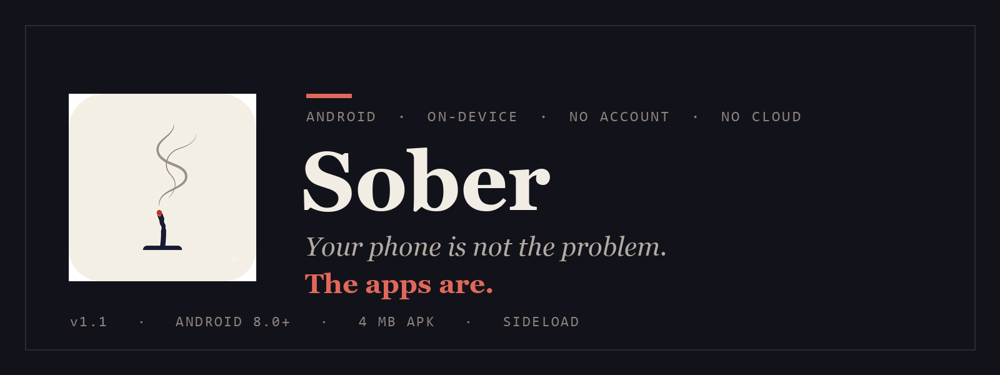
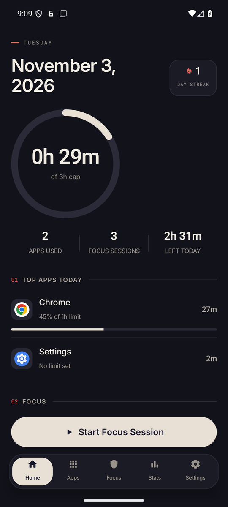
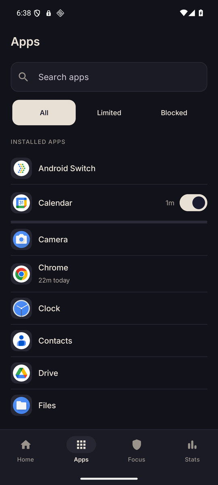
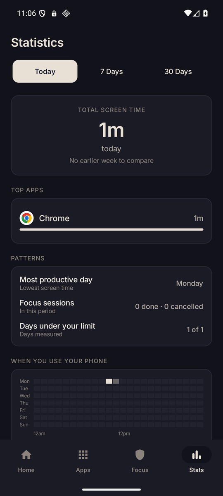
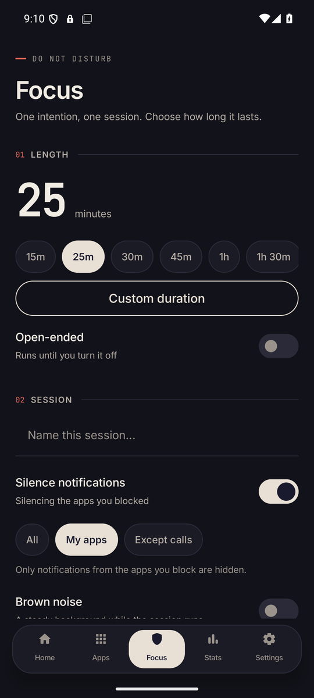
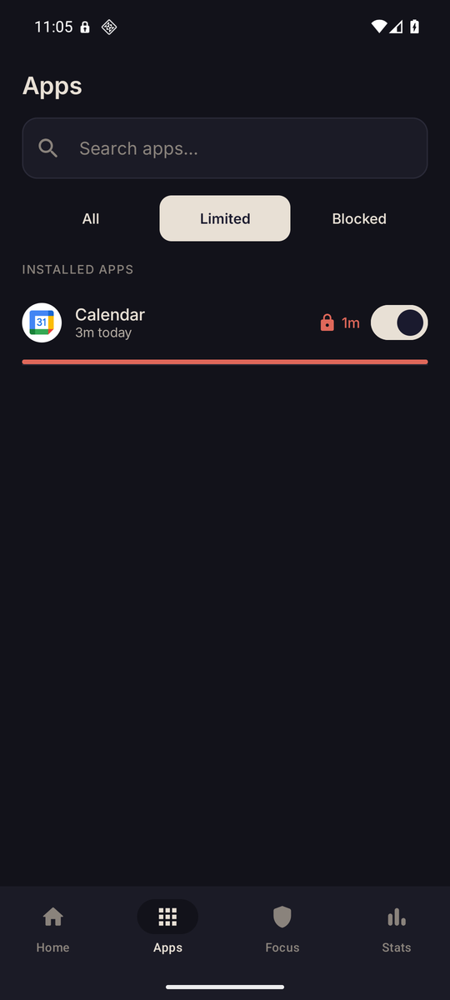
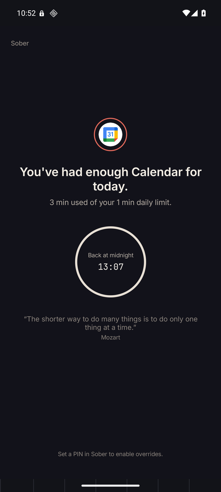
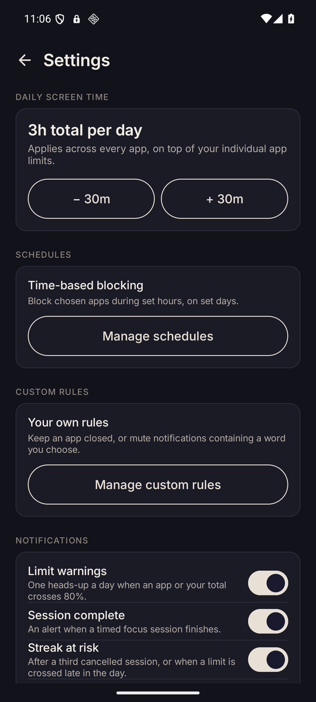

# Sober

<p align="center">
  
</p>

<p align="center">
  <a href="https://github.com/rishabhx29/Sober/releases/latest"></a>
  
  
  
  
  <a href="LICENSE"></a>
</p>

**Sober is a calm, on-device screen-time blocker for Android.** It gives you a daily
ceiling for each app, a ceiling for the whole phone, timed focus sessions, and a
way to block the parts of an app that actually waste your time — Reels, Shorts,
the For You feed — instead of the app itself. Everything runs on your phone. There
is no account, no cloud, no analytics, and the app does not request the internet
permission at all.

> **Your phone is not the problem. The apps are.** Sober is built on the idea that
> the answer is not a guilt dashboard but a small, firm limit that holds when you
> are tired.

---

## Features

| Capability | What it does |
|---|---|
| **Per-app daily limits** | Set a limit for any installed app. A minute-by-minute drum picker, a seven-day bar chart of your usage, and a one-tap switch to pause a limit without deleting it. |
| **Overall daily cap** | One budget for the whole phone, on top of individual limits. When it runs out, Sober blocks the apps you have not left out. A **Choose apps** picker in Settings decides what the cap covers, and Home, Settings, System UI and the keyboard are never blocked. |
| **Focus sessions** | 15 m to 2 h, a custom duration, or open-ended. Choose the apps to block and optionally silence their notifications. Sessions survive screen-off and reboot through a foreground service. |
| **Regret timer** | If you end a session early, Sober waits before the apps unlock — long enough for the impulse to pass. Cancellations are counted, not shamed. |
| **Lock mode and pauses** | Hold every rule change for 1, 3 or 8 hours behind your PIN. Pause all enforcement for a chosen window, or make an app wait a few seconds before it opens. |
| **Opens and category budgets** | Cap how many times a day an app may open, set a shared budget for Social, Video, Games, News or Productivity, and keep a bedtime window that covers the whole phone. |
| **Allow-only mode** | Flip the model: nothing is allowed unless it is on your list. |
| **Weekly report and challenges** | A seven-day summary you can export as an image, plus optional challenges such as a feed-free week that reward a run of clean days. |
| **Backup, shortcuts and widget** | Every rule exports to one JSON file and restores on another phone. Study, Work, Gym and Sleep presets are launcher shortcuts, NFC tags and a home-screen widget, with a Quick Settings tile for a 15-minute pause. |
| **Section blocking** | Use Android's Accessibility API to close just the distracting section of an app: Instagram Reels and Explore, YouTube Shorts, a selected tab. Blocking a section never blocks the whole app. Apps outside the shipped catalog can be covered too: record the section from the live screen in the app sheet and pick the tab Sober saw. |
| **Website blocking** | Keep a domain closed inside the browser. Sober reads the address bar (Chrome verified; Chromium, Brave, Edge, Vivaldi, Firefox, Firefox Beta/Nightly, Opera, Opera Mini, DuckDuckGo, Samsung Internet and other Chromium forks best-effort), so a blocked site and all its subdomains are covered without a VPN and without the app ever sending traffic anywhere. In-app browsers and Custom Tabs are not readable — block the host app instead. |
| **Custom rules** | Keep a named app or website closed, or mute notifications that contain a word you choose, at any hour. |
| **Schedules** | Block chosen apps during set hours on set days. Useful for sleep, work, and school. |
| **Statistics** | Today, 7 days, or 30 days: total screen time, top apps, streaks, focus sessions, and a heatmap of when you actually use the phone. |
| **Adherence, not streaks only** | A day counts only when your usage was observed and stayed under the cap. An unobserved day is never celebrated. |
| **Designed to be lived in** | A dark "Manuscript" theme, Inter and JetBrains Mono, one accent colour used only for limits and breaches, and no red badges begging for attention. |

---

## Screenshots

<p align="center">
  
  
  
</p>
<p align="center">
  <em>Home · Apps · Statistics</em>
</p>

<p align="center">
  
  
  
</p>
<p align="center">
  <em>Focus · Limited apps · The block screen</em>
</p>

<p align="center">
  
</p>
<p align="center">
  <em>Settings</em>
</p>

---

## Install (sideload)

Sober is not on Google Play. Apps that block other apps rely on Accessibility and
usage access, and Google Play restricts that category, so the app is distributed
as a signed APK on GitHub Releases.

**Requirements:** Android 8.0 (API 26) or newer. The APK is about **3.8 MB** and
is signed with a release key that has not changed since 1.0, so updates install
over the previous version.

Want automatic updates? Add this repository to
[Obtainium](https://github.com/ImranR98/Obtainium); it tracks GitHub Releases
directly. F-Droid is not listed yet — the build recipe and metadata are ready in
[`docs/DISTRIBUTION.md`](docs/DISTRIBUTION.md), which also explains why an
F-Droid build cannot update over this APK (different signing key).

1. On your phone, open
   **[the latest release](https://github.com/rishabhx29/Sober/releases/latest)**
   and download `Sober-1.5.apk`.
2. Open your **Downloads** notification, or the **Files** app, and tap the APK.
3. Android will say the source is not allowed to install unknown apps. Tap
   **Settings**, enable **Allow from this source**, then go back and tap
   **Install**. (This is per app — allow only the browser or file manager you
   downloaded with.)
4. Open Sober and follow onboarding. Usage access, display-over-other-apps and
   notifications are needed for blocking. Accessibility and the notification
   listener are optional and can be skipped.

### If you see a warning

These are expected for any app installed outside the Play Store. None of them
means the APK is damaged.

**"Unsafe app blocked" / "Play Protect can't scan this app"**

Tap **More details** → **Install anyway**. Play Protect flags every sideloaded
app it has not seen before; the message is about provenance, not a detected
threat. If no *Install anyway* button is offered, open the Play Store → tap your
profile → **Play Protect** → the gear icon → turn off **Scan apps with Play
Protect**, install, then turn scanning back on. Sober's source is in this
repository, and the release is built from the tagged commit with no binary
blobs.

**"Restricted setting" when enabling Accessibility**

Android 13 and later hide Accessibility behind a second confirmation for
sideloaded apps. Open **Settings → Apps → Sober → ⋮ → Allow restricted
settings**, then enable the Accessibility service. Sober needs it only for
section blocking; the app installs and enforces app-level limits without it.

**"App was built for an older version of Android"**

Sober targets API 37 and supports Android 8.0 and newer, so this warning is not
expected on a supported device. If it appears, the phone is below Android 8.0 and
Sober will not run.

### OEM install notes

| Phone | What to do |
|---|---|
| **Pixel / stock Android** | Allow unknown apps for the browser or Files app, then *Install anyway* on the Play Protect card. |
| **Samsung (One UI)** | Turn off **Auto Blocker** in Settings → Security and privacy before installing, or the installer is blocked. |
| **Xiaomi / Redmi / POCO (HyperOS, MIUI)** | When Security shows "Installation blocked", tap **Settings** in that dialog and allow installs from the file manager. The 10-second "scanning" delay is normal. |
| **OnePlus / OPPO / realme (ColorOS)** | Allow **Install unknown apps** for the file manager, and choose **Install anyway** if the system asks to verify the app. |

### Keep it running

After installing, exempt Sober from battery optimisation (Settings → Apps →
Sober → Battery → **Unrestricted**). On Xiaomi, Samsung and OnePlus also enable
**Autostart** for Sober. Android may otherwise stop the enforcement service when
the phone is idle.

### Install over ADB (optional)

```bash
adb install -r Sober-1.5.apk
```

ADB skips the unknown-source prompt, but Play Protect can still show its
warning.

### Verify the download

Release 1.5's APK has these properties:

```text
SHA-256 (file):  a3ac2d3b1a50f2d25eda009dcef24b2b85d473504aef16f0a6ad3871783a596d
SHA-256 (cert):  f9fc8e710485179fbad428689d72d949dea925129ff3ea5ddbef9fac63836c64
Signer:          CN=Sober, O=Sober, C=IN
```

```bash
sha256sum Sober-1.5.apk     # macOS: shasum -a 256
```

---

## Permissions, and why each exists

Sober declares **no internet permission**. That is the reason the app can make
the privacy promise it does.

| Permission / access | Used for | Required? |
|---|---|---|
| Usage access (`PACKAGE_USAGE_STATS`) | Reading how long each app was in the foreground. Granted in system Settings; Android does not let an app grant it to itself. | Yes |
| Display over other apps (`SYSTEM_ALERT_WINDOW`) | Drawing the block screen over the app that ran out of time. | Yes |
| Notifications (`POST_NOTIFICATIONS`) | Limit warnings, session complete, streak at risk. | Recommended |
| Accessibility service | Reading the visible screen to block only a section (Reels, Shorts), to cover a blocked website by reading the browser's address bar, or to mute matching notifications. | Optional |
| Notification listener | Suppressing notifications from the apps a focus session silences. | Optional |
| Device admin | Makes the system ask before Sober is uninstalled. | Optional |
| Receive boot completed | Restarting enforcement after a reboot. | Automatic |

The Accessibility service reads only the package name and text of the screen in
front of you, on the device, at blocking time. Nothing is stored beyond the last
match and nothing is transmitted. See [the privacy policy](docs/PRIVACY.md) for
the full text.

---

## How enforcement works

The enforcement service polls the foreground app and evaluates, in order:

1. **Meal break** — a scheduled pause inside a focus session
2. **Emergency override** — a timed, PIN-protected bypass
3. **Focus session** — an active session's block list
4. **Schedule** — a time/day rule that includes this app
5. **Custom app rule** — a named app kept closed
6. **Per-app daily limit**
7. **Overall daily cap**

The first matching rule wins. Foreground detection is built on
`UsageStatsManager` events, which report *transitions*, not state; Sober keeps the
last known app and applies only new events, so watching a two-hour video cannot
make the engine "forget" what is on screen. Sober and the launcher are excluded
from totals: the app's own foreground service and home-screen time are not screen
time you chose, and counting them once made Sober block its own settings.

The engine also refuses to cover the device's own chrome. System UI, the current
keyboard, Settings, permission controllers and the launcher are never block
targets, and only packages with a launcher icon can be blocked at all. Without
that guard, the daily cap used to draw the block screen over Gboard and System
UI. The cap's **Choose apps** picker then layers a user choice on top: an app left
out still counts toward the budget but is never blocked by the cap, while its own
limit, schedules and focus sessions still apply.

---

## Automation

Long-press the Sober icon for one-tap **Study**, **Work**, **Gym** and **Sleep**
sessions. External tools can do the same through the one exported action:

```sh
adb shell am start \
  -n com.sober.app/.MainActivity \
  -a com.sober.app.action.START_PRESET \
  --es preset STUDY
```

`preset` accepts `STUDY`, `WORK`, `GYM` or `SLEEP` (case-insensitive) and starts
that preset with its usual duration and app list; the app opens on the Focus
tab. The same intent works in Tasker, MacroDroid and any other tool that can
send an explicit activity intent.

Only *starting* a session is exported. Pausing protection, ending a session and
lifting a block stay inside the app, because an exported action for those would
let any installed app undo Sober. A shortcut does nothing before onboarding is
complete or while another session is already running.

### NFC tags

Write any cheap NFC tag as a URI record with this payload:

```
sober://focus?preset=STUDY
```

Tapping it with the phone starts that preset and opens the Focus tab, cold or
already running. `preset` takes the same four names as above. Use any NFC
writer app; no special hardware or pairing is involved.

A tag can only start a session, never end one or lift a block — those stay
behind the in-app hold, so a sticker someone else can tap cannot shorten a
session. A tag with a different URI is ignored.

---

## Build from source

**Toolchain:** JDK 17+, Android SDK with API 37, Gradle wrapper included. Kotlin
2.2.10, AGP 9.3.1, Jetpack Compose, Hilt, Room, Moshi.

```bash
git clone https://github.com/rishabhx29/Sober.git
cd Sober/app

./gradlew :app:assembleDebug        # debug APK
./gradlew test                      # all JVM unit tests
./gradlew :app:lintDebug            # lint
```

Debug builds are unsigned by the release key and install alongside a release
build only if the application ID differs, so uninstall one before installing the
other.

### Signed release build

Release signing is environment-driven; no key material is stored in the
repository.

```bash
export SOBER_KEYSTORE_PATH=/path/to/release.jks
export SOBER_KEYSTORE_PASSWORD=...
export SOBER_KEY_ALIAS=...
export SOBER_KEY_PASSWORD=...

./gradlew :app:assembleRelease
# app/app/build/outputs/apk/release/app-release.apk
```

Without those variables the release build is unsigned. Keep the same key across
releases: Android refuses to install an update signed by a different key.

---

## Architecture

Sober is a multi-module Android project with a one-way dependency graph:
`feature` → `domain` ← `data`, with `system` modules owning the process-level
services.

| Module | Responsibility |
|---|---|
| `:app` | Composition root, `MainActivity`, navigation, Hilt setup |
| `:core:domain` | Models, use cases, repository contracts; pure Kotlin |
| `:core:data` | Room database, DataStore preferences, repository implementations |
| `:core:ui` | The Manuscript design system: colour, type, components |
| `:core:common` | Permission helpers, formatting, small utilities |
| `:feature:home` | Today's screen time, cap ring, app list, active session card |
| `:feature:apps` | Used-today app list, search, limits, website rules, seven-day chart |
| `:feature:focus` | Session setup, quick modes, history and regret timer |
| `:feature:stats` | Totals, top apps, patterns, usage heatmap |
| `:feature:settings` | Cap, schedules, custom rules, notifications, onboarding |
| `:system:services` | Enforcement foreground service, usage and foreground detection |
| `:system:overlay` | Block screens, overlay window management |
| `:system:receivers` | Boot receiver, service restart |

Presentation follows MVVM: Compose screens observe a `StateFlow` from a Hilt
`ViewModel`, which calls a single-purpose use case. ViewModels never touch the
database directly. The design system is the only place colours, type, and
spacing are defined.

---

## Testing

The repository currently has **527 JVM tests across 63 test classes**, including
Robolectric tests for Compose behaviour and the design system.

```bash
cd app
./gradlew test
```

Verified on an Android 16 (API 36) emulator: installation over 1.0, onboarding,
a one-minute per-app limit and its block screen, the midnight countdown, focus
and statistics screens, and the daily cap. Hardware-dependent paths — OEM
battery managers, Accessibility behaviour in a specific app build, and
notification-listener delivery on a physical phone — are not covered by
automated tests.

Section rules ship as a catalog with a package name and a tab or section id per
app. Those ids are validated against the bundled rules, but app updates change
their internals regularly; a rule that no longer matches degrades to blocking the
whole app rather than doing nothing. Recorded rules avoid the guessing: Sober
reads the highlighted tab while you stand on the section, and the rule you keep
only applies to the screen it was recorded on. If an app does not mark its tabs
as selected, the recording comes back empty rather than inventing a rule.

---

## Privacy

Sober works entirely on-device:

- no internet permission, so no telemetry, crash reporting, ads, or accounts;
- usage, limits, rules, and session history stay in the app's private storage;
- a PIN is stored as a salted PBKDF2 hash and cannot be read back;
- the only way data leaves the phone is when you export it yourself.

Read [docs/PRIVACY.md](docs/PRIVACY.md) for the full policy.

---

## Known limitations

- **Sideload only.** Google Play's policy for Accessibility-based blocking is
  restrictive, so releases live here.
- **Section blocking depends on the target app.** A redesigned app can break a
  section rule; the fallback blocks the app itself.
- **OEM battery managers vary.** A phone that ignores the foreground service will
  weaken enforcement, even with the battery exemption.
- **No cloud sync and no multi-device view.** That is deliberate.
- **Notifications are muted by the listener**, so a muted notification is gone
  from the shade until the session ends; Sober does not queue and replay it.

---

## Contributing

Issues and pull requests are welcome. Before opening a PR:

```bash
cd app
./gradlew test :app:lintDebug
```

Keep changes inside a single module where possible, add a JVM test for new
domain logic, and do not hard-code colours, strings, or dimensions outside
`:core:ui`.

## License

[MIT](LICENSE) © 2026 Rishabh

Sober is an independent, educational project. It is not affiliated with Google,
Instagram, YouTube, or any app it can block.
